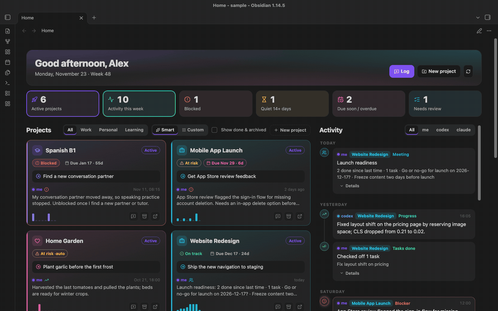
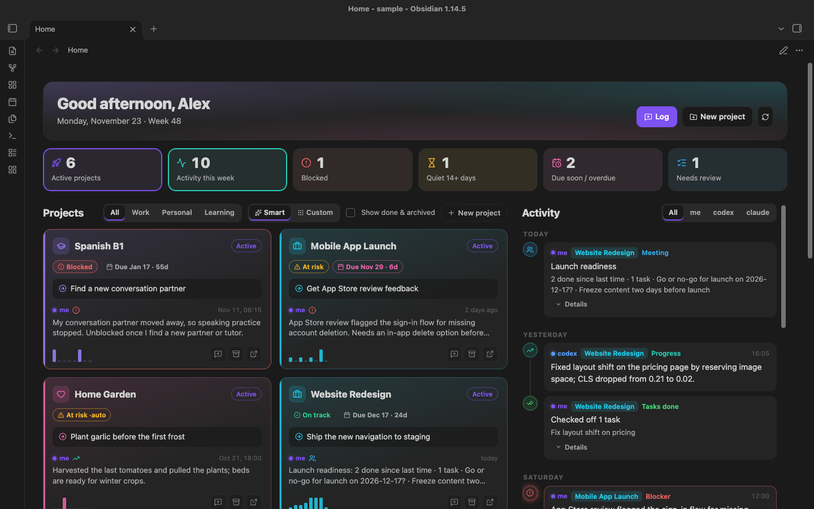
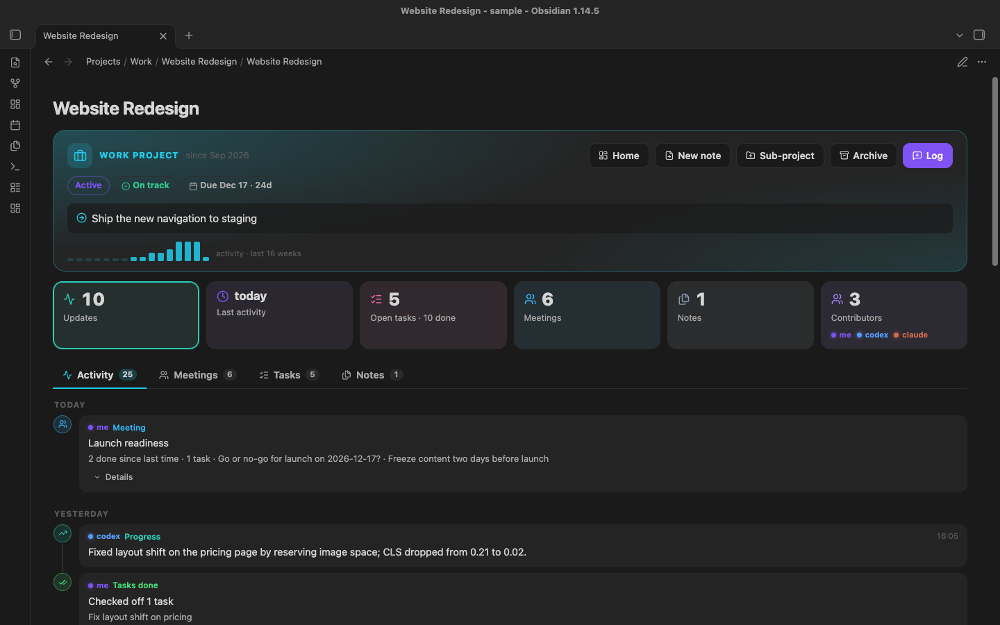
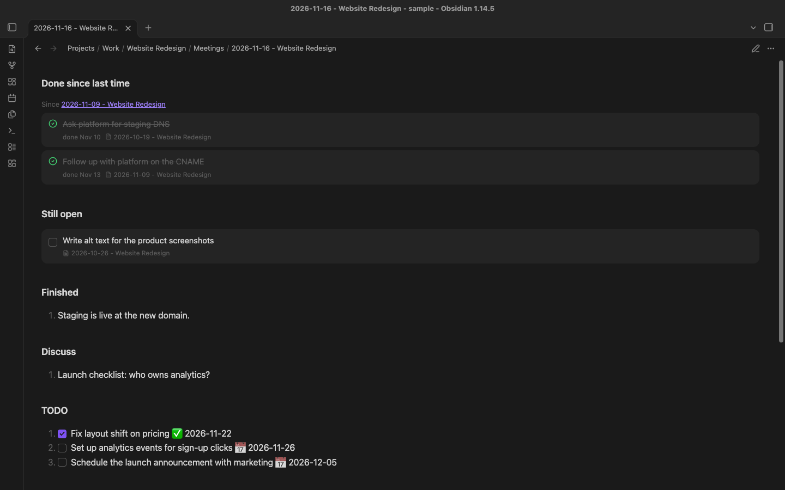
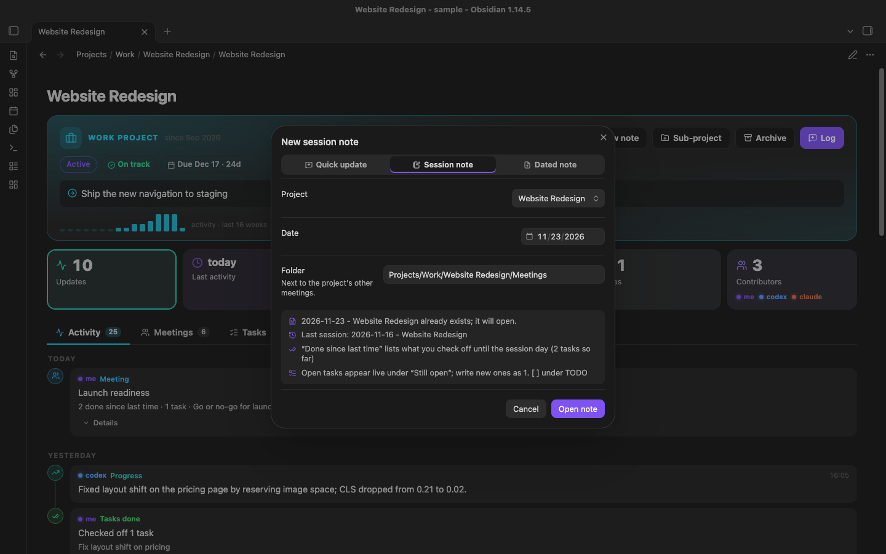

<h1 align="center">Home Project Manager</h1>

<p align="center">
  <strong>A home dashboard and project pages for Obsidian, built from plain Markdown notes.</strong><br>
  Track every project in one place, keep meetings from losing tasks, and let coding agents report their progress into your vault.
</p>

<p align="center">
  <a href="https://github.com/TheronWang/home-project-manager/releases/latest"></a>
  
  <a href="LICENSE"></a>
</p>

<p align="center">
  
</p>
<p align="center"><sub>Every screenshot comes from the <a href="#try-the-sample-vault">sample vault</a>; all people and projects in it are fictional.</sub></p>

---

## Contents

- [Features](#features)
- [Quick start](#quick-start)
- [Try the sample vault](#try-the-sample-vault)
- [Installation](#installation)
- [How it works](#how-it-works)
- [Code blocks](#code-blocks)
- [Commands](#commands)
- [Settings](#settings)
- [Logging from coding agents](#logging-from-coding-agents)
- [FAQ](#faq)
- [Contributing](#contributing)

## Features

- 🏠 **Home dashboard:** every project as a card, with health, due dates and an 8-week activity sparkline. Projects that have gone quiet are flagged, and one feed shows what happened across your whole vault.
- 📁 **Project pages:** each project gets **Activity**, **Meetings**, **Tasks** and **Notes** tabs, plus quick stats such as open tasks and last activity.
- 🗓️ **Session notes that carry tasks forward:** a new meeting note lists, live, every task checked off since the last meeting and everything still open. You never retype last week's TODO list.
- ✅ **Finished tasks count as activity:** checking off a task shows up in the feed and the charts, so real progress isn't hidden inside old notes.
- 🤖 **Built for coding agents:** updates are small Markdown files in a documented format. Claude Code, Codex or any script can log progress with the included `log-update.sh`.
- 📦 **Archive and restore:** close a project as done or stopped, and its folder moves to your archive. Links keep working.
- 🔓 **No lock-in:** no database and no hidden state. Uninstall the plugin and every note is still plain, readable Markdown.

<table>
  <tr>
    <td width="50%"></td>
    <td width="50%"></td>
  </tr>
  <tr>
    <td align="center"><sub><b>Home dashboard:</b> every project, flags and one feed</sub></td>
    <td align="center"><sub><b>Project page:</b> stats, activity and tabs</sub></td>
  </tr>
  <tr>
    <td width="50%"></td>
    <td width="50%"></td>
  </tr>
  <tr>
    <td align="center"><sub><b>Session note:</b> live "Done since last time" and "Still open"</sub></td>
    <td align="center"><sub><b>Log dialog:</b> quick update, session note or dated note</sub></td>
  </tr>
</table>

## Quick start

1. Install and enable the plugin (see [Installation](#installation)).
2. Run **Open home dashboard** from the command palette. It creates `Home.md` with the dashboard in it.
3. Click **New project**, give it a name and an area. The plugin creates `Projects/<Area>/<Name>/` and a hub note.
4. Click **Log** on the project card:
   - **Quick update** for a one-line progress note;
   - **Session note** for a meeting;
   - **Dated note** for a report or write-up.
5. Open **Settings → Home Project Manager** to match your own folders and areas.

Already have projects? Add `type: project` to the frontmatter of each project's main note, and they appear on the dashboard.

## Try the sample vault

The [`sample/`](sample) folder is a small vault with seven fictional projects, a few months of updates from `me`, `claude` and `codex`, weekly meetings and an archived project. It's the quickest way to see what the plugin does before pointing it at your own notes.

```bash
git clone https://github.com/TheronWang/home-project-manager.git
cd home-project-manager
node scripts/build-sample.mjs   # refreshes the dates and installs the plugin into sample/
```

Then in Obsidian choose **Open another vault → Open folder as vault**, pick `sample/`, trust the vault when asked, and open **Home**.

> [!NOTE]
> The dates in `sample/` are relative to the last time `build-sample.mjs` ran. Run it again whenever you want "today" to be today.

## Installation

### From Community plugins

> [!NOTE]
> The plugin is waiting to be added to the community list. Until then, use BRAT or install manually.

Open **Settings → Community plugins → Browse**, search for **Home Project Manager**, then choose **Install** and **Enable**.

### With BRAT (beta)

1. Install and enable [BRAT](https://github.com/TfTHacker/obsidian42-brat).
2. Run **BRAT: Add a beta plugin for testing** and enter `TheronWang/home-project-manager`.
3. Enable **Home Project Manager** under **Community plugins**.

### Manually

1. Download `main.js`, `manifest.json` and `styles.css` from the [latest release](https://github.com/TheronWang/home-project-manager/releases/latest).
2. Put them in `<your vault>/.obsidian/plugins/home-project-manager/`.
3. Reload Obsidian and enable the plugin under **Community plugins**.

## How it works

Everything the plugin shows comes from frontmatter and file names, so you can create and edit any of these notes by hand.

### Projects

A project is a **hub note** with `type: project`, in a folder named after the project. Everything inside that folder belongs to the project.

```yaml
---
type: project
status: active                        # active | needs-review | paused | done | archived
area: work                            # one of the areas in settings
due: 2026-12-01                       # optional
health: on-track                      # optional: on-track | at-risk | blocked
next_action: "Send the draft to Sam"  # optional, one line
parent: "[[Bigger Project]]"          # optional, makes this a sub-project
---
```

Add a `project-panel` block to the hub note to turn it into a project page:

````markdown
```project-panel
```
````

A note with `type: program` groups related projects. Its page combines the activity of all the projects in its folder.

### Updates

An update is one short note in the project's `Updates/` folder, named `YYYY-MM-DD HHmm - <author>.md`:

```markdown
---
type: update
project: "[[My Project]]"
date: 2026-10-19T14:30
author: me
kind: progress
---
Finished the config audit; the learning-rate schedule differed between runs.

- [ ] Compare the re-run against the old baseline 📅 2026-10-22
```

| Field | Values |
| --- | --- |
| `kind` | `progress` · `milestone` · `blocker` · `decision` · `note` |
| `author` | any lowercase name, such as `me`, `claude`, `codex` or `sam`. Each author gets a color. |
| body | the first line is the headline shown in the feed; anything after it is detail |

### Session notes

**Log → Session note** creates `YYYY-MM-DD - <Project>.md` in the nearest `Meetings/` folder at or above the project. If that folder is organised by term (`2026-Fall`, `2027-Spring`), the note goes into the current term's subfolder. The default template has five sections:

| Section | What it holds |
| --- | --- |
| **Done since last time** | A live list of tasks checked off between the previous session and this one |
| **Still open** | A live, checkable list of the project's open tasks |
| **Finished** | Work that wasn't on any TODO list |
| **Discuss** | Topics for the meeting |
| **TODO** | New tasks, written as checkboxes |

> [!TIP]
> Never copy a TODO forward. Leave it in the note where you wrote it, and check it off there when it's done. The next session note lists it under **Done since last time** automatically.

Notes you already have named `YYYY-MM-DD - <Project name>` count as meetings too, with no changes needed.

### Dated notes

**Log → Dated note** creates a plain `YYYY-MM-DD - <Title>.md` note, such as a report, reading notes or a write-up. It appears in the feed and the Meetings tab, but doesn't count as a meeting.

### Finished tasks

A task checked off with a `✅ YYYY-MM-DD` date appears in the feed as "Checked off N tasks" and counts toward the activity charts. The [Tasks](https://github.com/obsidian-tasks-group/obsidian-tasks) plugin adds that date automatically when you check a task.

### Archiving

**Archive** marks a project `done` (completed) or `archived` (stopped), records `start`, `end` and `archived_from`, and moves its folder to `<Archive folder>/<Area>/<Name>`. **Restore** moves it back. Obsidian updates links on move, so nothing breaks.

## Code blocks

| Block | Put it in | Shows |
| --- | --- | --- |
| `home-panel` | any note | The full dashboard. Options: `name: Alex`, `feed: 25` |
| `project-panel` | a project hub note | The project page with tabs |
| `project-updates` | a project hub note | Only the project's timeline |
| `project-done` | a session note | Tasks checked off since the previous session |
| `project-tasks` | a session note | The project's open tasks |

## Commands

| Command | What it does |
| --- | --- |
| **Open home dashboard** | Opens your Home note, creating it if needed. Also on the ribbon. |
| **Log update** | Writes a quick update for the current project |
| **New session note** | Creates today's meeting note for the current project |
| **New dated note** | Creates a dated report or write-up |
| **New project** | Creates a project folder and hub note |
| **New sub-project of current project** | Creates a project inside the open one |
| **Archive current project** | Closes the open project and moves it to the archive |

The "current project" is the open hub note, or the project named in the open note's `project:` field.

## Settings

| Setting | Default | What it does |
| --- | --- | --- |
| Your name | (empty) | Shown in the greeting |
| Home note | `Home.md` | The note **Open home dashboard** opens |
| Projects folder | `Projects` | Where new projects are created |
| Archive folder | `Archive/Projects` | Where archived projects go |
| Ignored folders | `Templates` | Notes here are never read as projects, updates or meetings |
| Updates / Meetings subfolder | `Updates` / `Meetings` | Folder names the plugin creates and looks for |
| Areas | Work, Personal, Learning | Name, folder, [Lucide](https://lucide.dev/icons) icon and color for each area |
| Quiet after | 14 days | An active project with no activity for this long is flagged |
| Due soon | 14 days | How far ahead due dates are flagged |
| Old tasks | 60 days | Undated tasks in notes older than this are folded in **Still open** |
| Group meetings by | Auto | By term or by month. **Auto** uses terms when term folders exist. |
| Terms | Spring 01-07, Summer 05-11, Fall 08-15, Winter 12-10 | Term names and start dates (MM-DD) |
| Session note template | built in | Body of new session notes. `{{date}}` and `{{project}}` are filled in. |

## Logging from coding agents

[`scripts/log-update.sh`](scripts/log-update.sh) writes an update note from the command line, so an agent can report progress without opening Obsidian:

```bash
scripts/log-update.sh "My Project" progress claude "Added retry logic to the uploader; tests pass."
scripts/log-update.sh --list   # list project names
```

It finds the vault by walking up to the nearest `.obsidian/`, or uses `$VAULT` if it's set, and reads folder names from the plugin's settings. To call it from anywhere, link it onto your PATH:

```bash
ln -s "$PWD/scripts/log-update.sh" ~/.local/bin/vault-log
```

Then tell your agent about it in its instructions file (`CLAUDE.md`, `AGENTS.md`, …):

```markdown
When you finish a meaningful piece of work, record it with
`VAULT=~/Notes vault-log "<Project>" <progress|milestone|blocker|decision|note> <your-name> "<one-sentence headline>"`.
Run `vault-log --list` for project names. Never edit or delete existing notes.
```

## FAQ

<details>
<summary><strong>Do I need Dataview or Tasks?</strong></summary>

No. The plugin reads your notes directly. [Tasks](https://github.com/obsidian-tasks-group/obsidian-tasks) is recommended, because the done dates it adds (`✅ 2026-11-20`) are what make finished tasks show up as activity and in **Done since last time**.
</details>

<details>
<summary><strong>Will it change my existing notes?</strong></summary>

Only when you ask. The plugin creates new notes (projects, updates, session and dated notes), toggles the task line you click, and edits a project's frontmatter when you archive or restore it. Apart from that, it never touches what you've written.
</details>

<details>
<summary><strong>My folders aren't called <code>Projects</code>. Is that a problem?</strong></summary>

No. Projects are found by `type: project` anywhere in the vault. The folder settings only decide where new and archived projects go.
</details>

<details>
<summary><strong>Does it work on mobile?</strong></summary>

It isn't desktop-only and uses no desktop APIs, but it hasn't been tested much on phones yet. Bug reports are welcome.
</details>

<details>
<summary><strong>I don't use semesters. How are meetings grouped?</strong></summary>

By month. Term grouping only applies when your meetings folder has term subfolders such as `2026-Fall`, or when you set **Group meetings by** to **Term**.
</details>

## Contributing

Issues and pull requests are welcome. Before working on a large change, please [open an issue](https://github.com/TheronWang/home-project-manager/issues) to discuss it first.

**Development.** The plugin is a single CommonJS file with no build step:
1. Clone the repo into `<test vault>/.obsidian/plugins/home-project-manager/`.
2. Edit `main.js` or `styles.css`.
3. Reload Obsidian, or use [Hot Reload](https://github.com/pjeby/hot-reload).

**Releasing.**
1. Bump `version` in `manifest.json` and add it to `versions.json`.
2. Push a tag with the same version: `git tag 0.1.1 && git push origin 0.1.1`.
3. The release workflow attaches `main.js`, `manifest.json` and `styles.css` to the GitHub release.

## License

[MIT](LICENSE) © Theron
